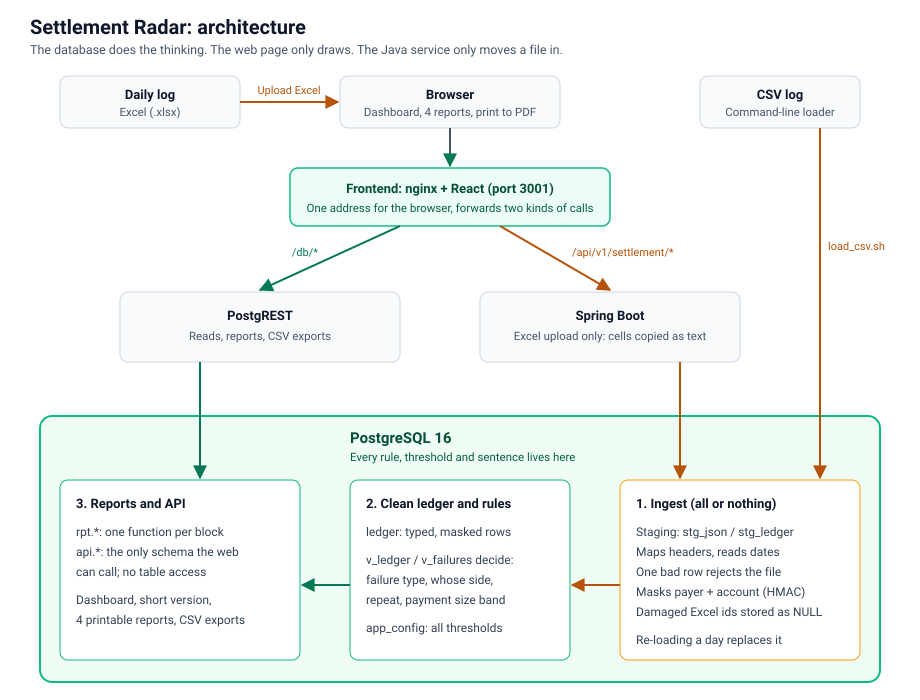

# Danny Mike Ganza Rwabuhama

I build software for the person standing inside the problem, from preserving survivor testimony at Rwanda's memorials to investigating failed transactions across 100k+ daily banking records without exposing a single identity.

**Looking for:** data engineering apprenticeships and software internships. Based in Kigali, open to remote.

---

## What I've Built

### Settlement Radar *(private · internship project)*
**Failed-payment investigation for clearing operations.** Loads a day's transaction log (100,000+ rows) from Excel or CSV, masks payer and account numbers inside the database transaction, and classifies every failed payment by type (timeout or rejection) and by whose side failed (our switch, the other participant, our own bank). It flags repeat failures and problem hours, and reports how much money is stuck, in a dashboard and four printable reports.

All business rules live in PostgreSQL functions: the web page only draws, and the Java service only moves a file in. A single unreadable row rejects the whole file, so a half-loaded day can never happen.

`PostgreSQL (PL/pgSQL)` · `Spring Boot (Java)` · `React + TypeScript` · `PostgREST` · `nginx` · `Docker`

Architecture

### PandemicNet *(team project)*
**Contact tracing and outbreak simulation for public health officers.** It started as a low-tech contact tracer and grew into a full platform.

- 🏆 [**pandemicNet**](https://github.com/DannyMikeGanzaRwabuhama/pandemicNet) won **1st Place at the RCA Annual Hackathon**. Flask + PostgreSQL contact tracing with a network graph, ML contact prediction and a Streamlit interface.
- [**pandemicnet-ai**](https://github.com/DannyMikeGanzaRwabuhama/pandemicnet-ai) is the larger rebuild. Neo4j holds the contact graph (multi-degree tracing, centrality, communities, superspreaders), a Random Forest scores transmission risk, and Gemini explains the results in plain language. A Next.js 15 dashboard shows a D3 network graph and a Leaflet map, and a LangGraph simulation runs six agents: movement, contact, infection, outbreak detection (reproduction number), intervention and daily report.

`Python` · `FastAPI` · `Neo4j` · `scikit-learn` · `LangGraph` · `Gemini API` · `Next.js` · `TypeScript` · `D3.js` · `Flask` · `PostgreSQL` · `Streamlit` · `Docker`

### FaceLocking & FaceLockingServo *(course projects)*
**Face recognition that locks onto one person, then acts on it.** FaceLocking recognizes enrolled people on an ordinary CPU (ArcFace embeddings, Haar detection, MediaPipe 5-point alignment) and tunes its acceptance threshold from false-accept and false-reject analysis. Once locked onto one identity it ignores everyone else and logs their blinks, smiles and movement.

FaceLockingServo turns that into a distributed system: the vision node publishes left, right or centered commands over MQTT, ESP8266 firmware subscribes and moves a servo, and a WebSocket dashboard shows the command stream. Phase 1 is open-loop (commands only, no servo feedback).

Repos: [FaceLocking](https://github.com/DannyMikeGanzaRwabuhama/FaceLocking) · [FaceLockingServo](https://github.com/DannyMikeGanzaRwabuhama/FaceLockingServo)

`Python` · `OpenCV` · `MediaPipe` · `ArcFace (ONNX)` · `MQTT` · `WebSocket` · `C++ (ESP8266)`

### Echoes of Memory *(private · team project)*
For younger generations and international visitors at Rwanda's genocide memorials, where a guide cannot stand beside every visitor in every language, and for the custodians who preserve these testimonies so they are never lost.

A trauma-informed, offline-first AR companion. Visitors scan ArUco markers to open survivor testimony, and sensitive content stays veiled until they choose to reveal it. Curators manage content in a web CMS, which pushes updates (SHA-256 checked, swapped in atomically) to a Raspberry Pi edge server at the site, so the app works with no internet.

Three parts: a Flutter app, a Next.js CMS and a Node.js edge server.

`Flutter (Dart)` · `OpenCV (ArUco)` · `Isar` · `Next.js` · `PostgreSQL` · `Node.js`

---

## Tech

**Languages:** `Python` · `Java` · `SQL (PL/pgSQL)` · `TypeScript` · `Dart` · `C++` · `JavaScript`
**Backend and data:** `Spring Boot` · `FastAPI` · `Flask` · `Node.js` · `PostgreSQL` · `Neo4j` · `PostgREST`
**Frontend and mobile:** `React` · `Next.js` · `D3.js` · `Flutter` · `Streamlit`
**ML, AI and vision:** `scikit-learn` · `NetworkX` · `LangGraph` · `Gemini API` · `OpenCV` · `MediaPipe`
**Infrastructure and IoT:** `Docker` · `nginx` · `MQTT` · `ESP8266`